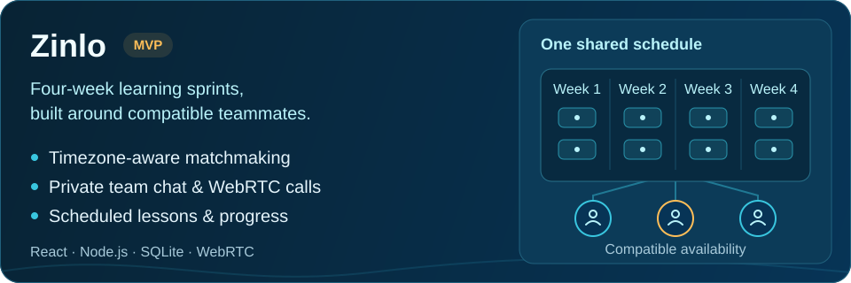
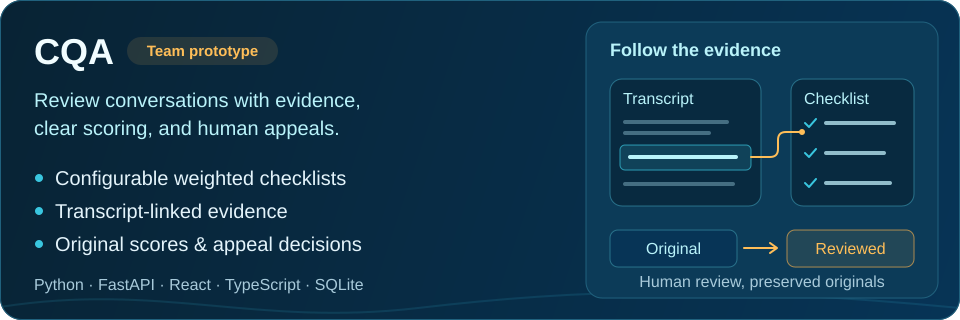
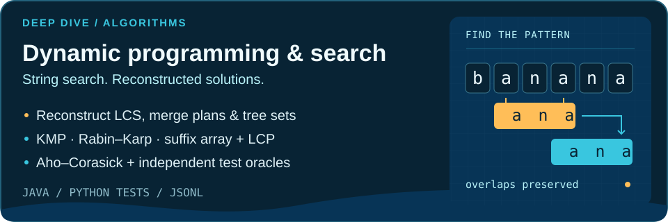
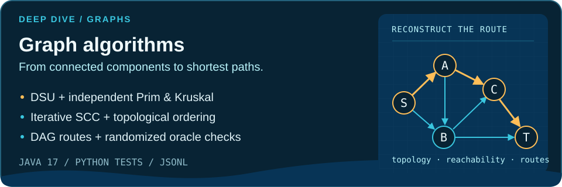
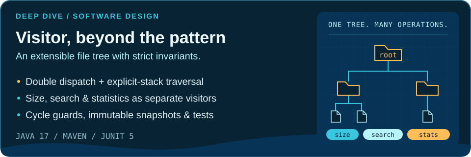

<p align="center"><strong>Building things. Going deep. Questioning the tea.</strong><br><sub>Code above sea level. Grand Blue energy everywhere else.</sub></p>

## Hey, I'm bigstep832 👋

<a href="https://raw.githubusercontent.com/bigstep832/bigstep832/main/assets/oolong-tea.gif"></a>

I build web apps with **React, Node.js, and Python**, and explore algorithms and software design in **Java**.

My projects go beneath the interface: matching teammates across time zones, connecting video calls, tracing scores back to evidence, and checking algorithms against independent oracles.

Pull up a chair. The code is open. The tea is questionable.

[Projects](#projects-worth-a-deep-dive) · [Toolbox](#toolbox) · [Club rules](#diving-club-config) · [Repositories](https://github.com/bigstep832?tab=repositories)

<br clear="both">


## Projects worth a deep dive

<p align="left"><a href="https://github.com/bigstep832/zinlo"><picture>
  <source media="(max-width: 640px)" srcset="assets/zinlo-card-mobile.svg">
  
</picture></a></p>

<details>
<summary>Inside Zinlo: matching, calls, and learning sprints</summary>

A full-stack MVP for four-week learning sprints: compatible teammates, a shared schedule, structured lessons, private chat, and browser-based video calls.

- **Matchmaking across time zones:** groups of 3–4 learners, eight compatible meetings, and daylight-saving edge cases.
- **WebRTC calls:** peer connections, audio/video, listen-only joining, signaling, and connection cleanup.
- **Learning progression:** server-enforced lesson unlocks based on the schedule and prior completion, with saved work and progress.

`React` `JavaScript` `Node.js` `SQLite` `Vite` `WebRTC` `Luxon`

[Matchmaking logic](https://github.com/bigstep832/zinlo/blob/main/server/matchmaking.js) · [Video peers](https://github.com/bigstep832/zinlo/blob/main/src/video-peer.js) · [Progression rules](https://github.com/bigstep832/zinlo/blob/main/server/progression.js)

</details>

<p align="left"><a href="https://github.com/bigstep832/cqa-hackathon"><picture>
  <source media="(max-width: 640px)" srcset="assets/cqa-card-mobile.svg">
  
</picture></a></p>

<details>
<summary>Inside CQA: evidence, scoring, and appeals</summary>

A team-built hackathon prototype for reviewing support conversations against configurable quality checklists, connecting assessments to transcript evidence and human appeals.

- **Explainable scoring:** weighted criteria, explicit N/A answers, separate violation flags, and deterministic rounding.
- **Evidence-linked review:** transcript highlights, criterion explanations, audio controls, and original versus effective scores.
- **Traceable appeals:** human review stays separate from original evaluations; idempotency keys protect against conflicting duplicate submissions.

`Python` `FastAPI` `Pydantic` `SQLAlchemy` `SQLite` `React` `TypeScript`

[Scoring engine](https://github.com/bigstep832/cqa-hackathon/blob/main/backend/app/domain/scoring.py) · [Review workspace](https://github.com/bigstep832/cqa-hackathon/blob/main/frontend/src/ReviewWorkspace.tsx) · [Appeal handling](https://github.com/bigstep832/cqa-hackathon/blob/main/backend/app/services/appeals.py)

</details>

<p align="left"><a href="https://github.com/bigstep832/daa-assignment-4-final/tree/main/Java/source"><picture>
  <source media="(max-width: 640px)" srcset="assets/algorithms-card-mobile.svg">
  
</picture></a></p>

<details>
<summary>Inside the algorithms: implementation and verification</summary>

Eight Java algorithms with solution reconstruction, independent oracle testing, and reproducible search benchmarks.

- **Dynamic programming:** LCS reconstruction, optimal adjacent merging with executable merge plans, and iterative tree maximum-weight independent set.
- **String search:** KMP, collision-checked Rabin–Karp, suffix arrays with Kasai LCP, and Aho–Corasick.
- **Verification:** exhaustive and randomized oracles, witness validation, full-limit stress cases, and benchmarks with warmups and repeated runs.

`Java` `Python test tooling` `JSONL`

[Implemented algorithms](https://github.com/bigstep832/daa-assignment-4-final/blob/main/Java/source/Algorithms.java) · [Independent tests](https://github.com/bigstep832/daa-assignment-4-final/blob/main/tests/student/test_solution.py) · [Search benchmark](https://github.com/bigstep832/daa-assignment-4-final/blob/main/tests/student/SearchBenchmark.java)

</details>

<p align="left"><a href="https://github.com/bigstep832/Assignment_3_DAA/tree/main/Assignment_3_Java17_submission"><picture>
  <source media="(max-width: 640px)" srcset="assets/graphs-card-mobile.svg">
  
</picture></a></p>

<details>
<summary>Inside the graph toolkit: forests, components, and routes</summary>

Six graph algorithms covering connectivity, spanning forests, strongly connected components, and reconstructable routes in DAGs.

- **Spanning forests:** DSU with path compression and union by size, plus independent Kruskal and heap-based Prim implementations.
- **Graph structure:** iterative Kosaraju, topological sorting, and deduplicated SCC condensation edges.
- **Shortest paths:** negative weights in DAGs, 64-bit totals, original-edge route reconstruction, and independent stress tests.

`Java 17` `Python verification` `JSONL`

[Completed implementation](https://github.com/bigstep832/Assignment_3_DAA/blob/main/Assignment_3_Java17_submission/src/Java/Algorithms.java) · [Oracle tests](https://github.com/bigstep832/Assignment_3_DAA/blob/main/Assignment_3_Java17_submission/tests/run_own.py) · [Benchmark](https://github.com/bigstep832/Assignment_3_DAA/blob/main/Assignment_3_Java17_submission/tests/benchmark/Benchmark.java)

</details>

<p align="left"><a href="https://github.com/bigstep832/visitor-pattern-assignment"><picture>
  <source media="(max-width: 640px)" srcset="assets/visitor-card-mobile.svg">
  
</picture></a></p>

<details>
<summary>Inside Visitor: traversal, invariants, and tests</summary>

An extensible in-memory file tree built around Visitor, double dispatch, and a sealed Java class hierarchy.

- **Separate operations:** size, predicate search, and statistics visitors share explicit-stack traversal.
- **Tree integrity:** rejects cycles, duplicate siblings, multiple parents, and invalid names.
- **Defensive design:** immutable child snapshots, checked arithmetic, visitor recovery after errors, and focused JUnit tests.

`Java 17` `Maven` `JUnit 5`

[Traversal](https://github.com/bigstep832/visitor-pattern-assignment/blob/main/src/main/java/edu/aitu/visitor/TreeVisitor.java) · [Tree invariants](https://github.com/bigstep832/visitor-pattern-assignment/blob/main/src/main/java/edu/aitu/visitor/DirectoryNode.java) · [Integrity tests](https://github.com/bigstep832/visitor-pattern-assignment/blob/main/src/test/java/edu/aitu/visitor/TreeIntegrityTest.java)

</details>

## Toolbox

<picture>
  <source media="(max-width: 640px)" srcset="assets/toolbox-mobile.svg">
  
</picture>

<details>
<summary>All tools used in the featured projects</summary>

| Area | Tools used in these projects |
| --- | --- |
| Interfaces | React, TypeScript, JavaScript, Vite |
| Backend & data | Node.js, Python, FastAPI, Pydantic, SQLAlchemy, SQLite |
| Real-time & scheduling | WebRTC, Luxon |
| Algorithms & design | Java 17, data structures, graph algorithms, design patterns |
| Testing | pytest, Vitest, Playwright, JUnit 5, randomized oracles |

</details>

## Diving club config

<a href="https://raw.githubusercontent.com/bigstep832/bigstep832/main/assets/water-test.gif"></a>

Trust the tests. Never trust the label on the glass.

```typescript
const tea = inspect(glass);
if (tea.flammable) {
  throw Error("Not water.");
}
```

<br clear="both">

<details>
<summary>🧊 Emergency tea cabinet — open after a failed build</summary>
<p align="center"><br><a href="https://tenor.com/view/grand-blue-gif-21543758"></a><br><strong>When the variable is called water, but the type is clearly wrong.</strong><br><em>TypeError: expected H₂O, received plot development.</em><br><sub>Reaction still from Grand Blue · <a href="https://tenor.com/view/grand-blue-gif-21543758">lynxlynx / Tenor</a></sub></p>
</details>

<p align="center"><sub>Yes, Grand Blue is a diving anime. We checked the README.</sub></p>

<p align="center"><sub>Grand Blue clips: <a href="https://tenor.com/view/oolong-tea-grand-blue-iori-gif-13475090">oolong tea</a> · <a href="https://media.tenor.com/uM-_uWPq9mAAAAAM/oolong-burn.gif">water test</a> · <a href="MEDIA-SOURCES.txt">media credits</a></sub></p>
