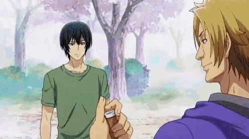
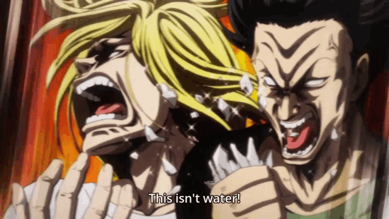
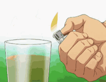

<strong>Water. Oolong tea. Totally a diving anime.</strong>

Diving into code, one project at a time.

[Projects](#selected-projects) · [Repositories](https://github.com/bigstep832?tab=repositories)

## Selected projects

### [Zinlo](https://github.com/bigstep832/zinlo)

A learning platform MVP built around four-week sprints with compatible teammates, private chat, and video calls. Built with React, Node.js, and SQLite.

### [Conversation Quality Analytics](https://github.com/bigstep832/cqa-hackathon)

A team hackathon prototype for configurable conversation evaluation, supporting evidence, and appeals. Built with Python, FastAPI, and SQLite.

### [Java design patterns](https://github.com/bigstep832/visitor-pattern-assignment)

A Java 17 in-memory filesystem that uses the Visitor pattern to calculate size, search files, and collect statistics. Includes Maven and JUnit 5.

## Technologies

`React` `JavaScript` `Node.js` `Python` `Java` `SQLite`

## Meanwhile, at the diving club

  
  

<em>Oolong tea. A completely normal reaction.</em> Scenes from Grand Blue · <a href="https://tenor.com/view/oolong-tea-grand-blue-iori-gif-13475090">GIF via Ledesmo / Tenor</a> · <a href="https://tenor.com/view/grand-blue-gif-21543758">Frame via lynxlynx / Tenor</a>

One more thing: does the water pass the test?

  <em>Definitely not water.</em> <a href="https://media.tenor.com/uM-_uWPq9mAAAAAM/oolong-burn.gif">GIF source: Tenor</a>

